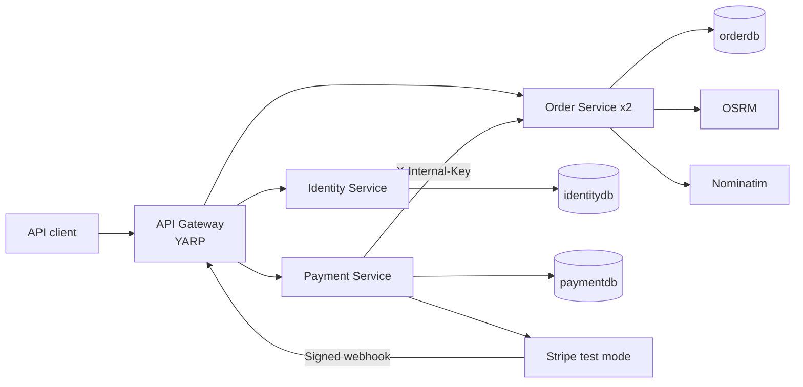

# Architecture

## Overview

Lesto uses four independently deployable .NET services:

1. API Gateway;
2. Identity Service;
3. Order Service;
4. Payment Service.

The services communicate through synchronous HTTP APIs and do not share
databases. Docker Compose starts two instances of the Order Service behind the
Gateway.

## Components

| Component | Responsibility | Data |
|---|---|---|
| API Gateway | Public entry point, routing, JWT validation and load balancing | None |
| Identity Service | Registration, login, users, roles and JWT issuance | `identitydb` |
| Order Service | Points, orders, pricing, geocoding and route optimisation | `orderdb` |
| Payment Service | Checkout, payment confirmation and refunds | `paymentdb` |
| OSRM | Road distance, duration and distance matrices | External |
| Nominatim | Portuguese free-text address geocoding | External |
| Stripe | Test payment processing | External |

One PostgreSQL container hosts the three logical databases during local
development. Each service only uses its own database.

## Communication

- Clients normally call the Gateway.
- The Gateway routes `/api/auth`, `/api/users`, `/api/orders`,
  `/api/points`, `/api/settings`, `/api/geocode`, `/api/routes` and
  `/api/payments`.
- Order Service calls Identity Service to validate a courier during assignment.
- Order Service calls Nominatim for new free-text addresses and OSRM for route
  distance and duration.
- Payment Service calls the Order Service internal endpoints using
  `X-Internal-Key`.
- Stripe sends signed webhooks to `/api/payments/webhook`.
- No service accesses another service's database.

## Authentication and security

- Identity Service issues HS256 JWTs with a 60-minute lifetime.
- The Gateway and backend services validate the same issuer, audience and
  signing key.
- Roles are `Cliente`, `Estafeta`, `Gestor` and `Administrador`.
- Internal payment/order calls use `X-Internal-Key` and are not routed by the
  Gateway.
- Stripe card details remain with Stripe.
- Secrets are supplied through `.env` or deployment configuration.

The local Compose file publishes service ports to simplify development. A
cloud deployment should expose only the Gateway and keep the other services
inside the private Docker network.

## Scalability demonstration

`order-service-1` and `order-service-2` use the same image. YARP distributes
Gateway requests using Round Robin. The response header `X-Served-By` can be
used to identify the responding instance.

This demonstrates horizontal deployment, but it is not transparent failover:
the current Gateway configuration has no retry or circuit-breaker policy.

## Deployment

| Environment | Runtime | Public endpoint |
|---|---|---|
| Local | Docker Compose | `http://localhost:5000` |
| Cloud demonstration | Linux VM and Docker Compose | HTTPS Gateway, normally port `8443` |

The cloud procedure is documented in [cloud/comandos.md](cloud/comandos.md).

## Scope limitations

The project intentionally does not include a message broker, asynchronous
processing, distributed tracing, metrics, CI/CD, live tracking or production
payment keys. These are possible future improvements, not required features.
