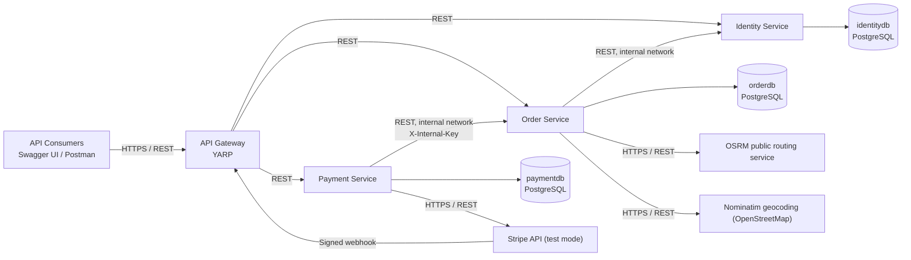

# Architecture

## 1. Architectural style

Lesto uses a microservices architecture with a single API Gateway. The three
business services are independently deployable and own their data. They use
synchronous REST communication because the reduced scope does not require
asynchronous processing.

## 2. Components

| Component | Responsibility | Publicly exposed | Data ownership |
|---|---|---:|---|
| API Gateway | Single entry point, routing, JWT validation, and HTTPS termination. | Yes | None. |
| Identity Service | Registration, login, JWT issuance, user and role management. | No | `identitydb`. |
| Order Service | Delivery points, orders, order state machine, weight setting, and statistics. | No | `orderdb`. |
| Payment Service | Stripe Checkout sessions, payment confirmation (webhook and query), refunds. | No | `paymentdb`. |
| OSRM | External route distance and duration calculation. | External provider | None. |
| Nominatim | External geocoding of free-text addresses (Portugal only). | External provider | None. |
| Stripe | External payment processing in test mode. | External provider | Card data stays at Stripe. |

One PostgreSQL container hosts three logical databases during development:
`identitydb`, `orderdb`, and `paymentdb`. Each service uses only its own connection string.

## 3. Communication

- API consumers call only the API Gateway.
- Gateway-to-service and service-to-service communication uses REST over the
  private Docker network.
- Order Service calls Identity Service only to validate a selected courier at
  assignment time.
- Order Service calls Nominatim only for free-text addresses that were not
  geocoded before, then calls OSRM with the resolved coordinates.
- Payment Service calls Order Service's internal endpoints
  (`/internal/orders/{id}` and `/internal/orders/{id}/payment`) with the
  `X-Internal-Key` header. These endpoints have no Gateway route.
- Payment Service calls Stripe to create Checkout Sessions, read their status,
  and create refunds. Stripe calls back through the Gateway route
  `/api/payments/webhook`, which is anonymous but signature-verified.
- There is no event broker, notification service, or direct database sharing.

## 4. Security design

- Identity Service issues 60-minute HS256 JWT access tokens.
- The Gateway and both services validate token signature, issuer, audience, and
  expiry. Each service also applies role authorization locally.
- The JWT secret is supplied through environment variables or cloud settings;
  it is never committed to Git.
- Only Gateway publishes host ports. PostgreSQL, Identity Service, and Order
  Service are reachable only on the internal Compose network.
- HTTPS is terminated by Gateway in cloud deployment. Development may use HTTP
  only on localhost.

## 5. Scalability and maintenance demonstration

Docker Compose runs two Order Service containers from the same image:
`order-service-1` and `order-service-2`. YARP uses both as destinations and
round-robins requests. Each response includes `X-Served-By` so the presentation
can demonstrate distribution. Restarting one Order Service container while the
other remains available demonstrates basic maintenance resilience.

## 6. Deployment environments

| Environment | Runtime | Public access |
|---|---|---|
| Local development | Docker Compose | Gateway on `http://localhost:5000`. |
| Cloud demonstration | Linux VM with Docker Compose | Gateway on HTTPS port `8443`; restricted firewall rule. |

## 7. Architecture decisions

- Three business services (Identity, Order, Payment) demonstrate a
  microservices design with separate data ownership and service-to-service
  calls in both directions of trust (user token and internal key).
- The point catalogue is kept, and free-text addresses are offered as an
  alternative; only the address text is sent to Nominatim, never the customer's
  identity.
- OSRM provides a relevant external integration without route optimisation.
- Docker Compose is used instead of Kubernetes because the assignment asks for
  scalability and maintenance scenarios but does not mandate Kubernetes.
