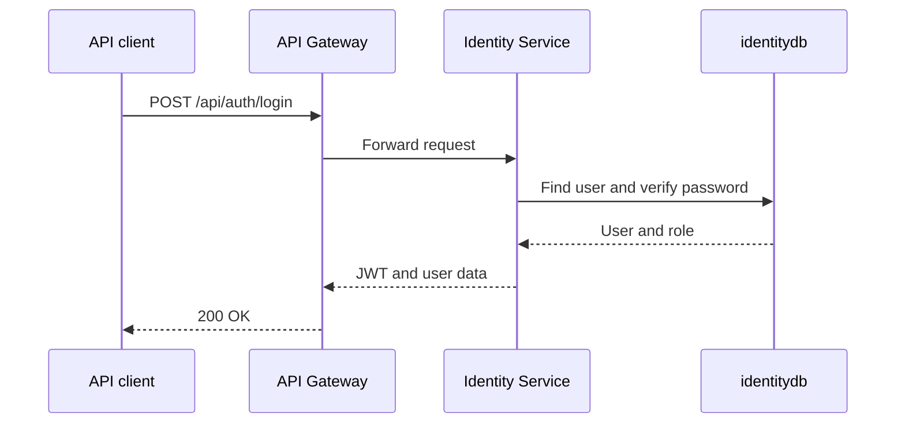
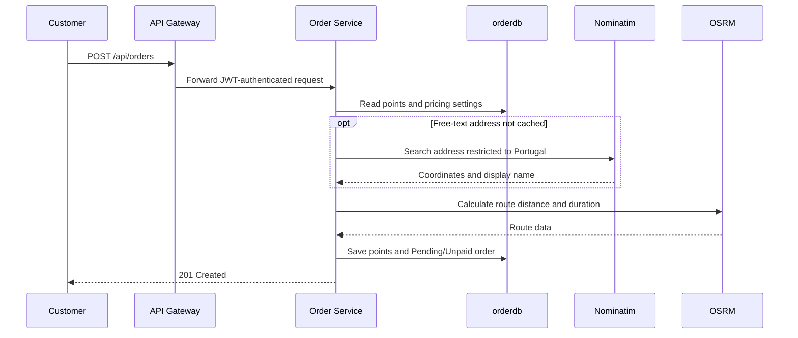
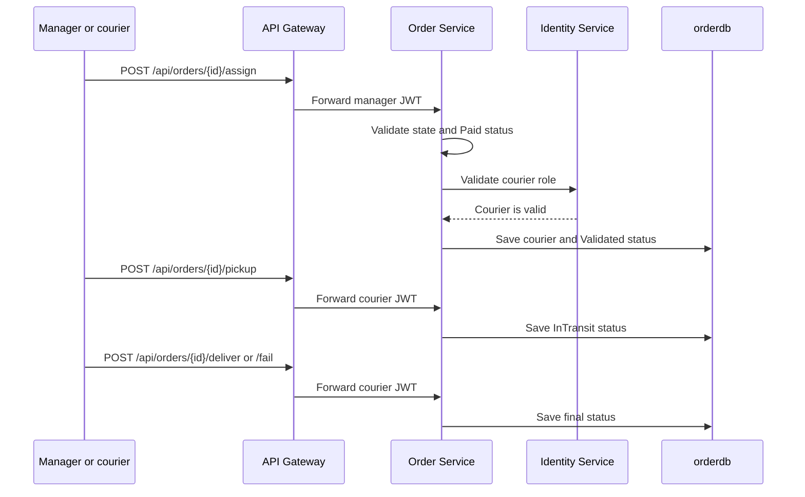
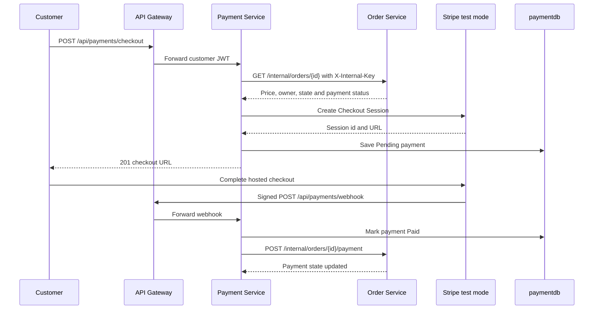
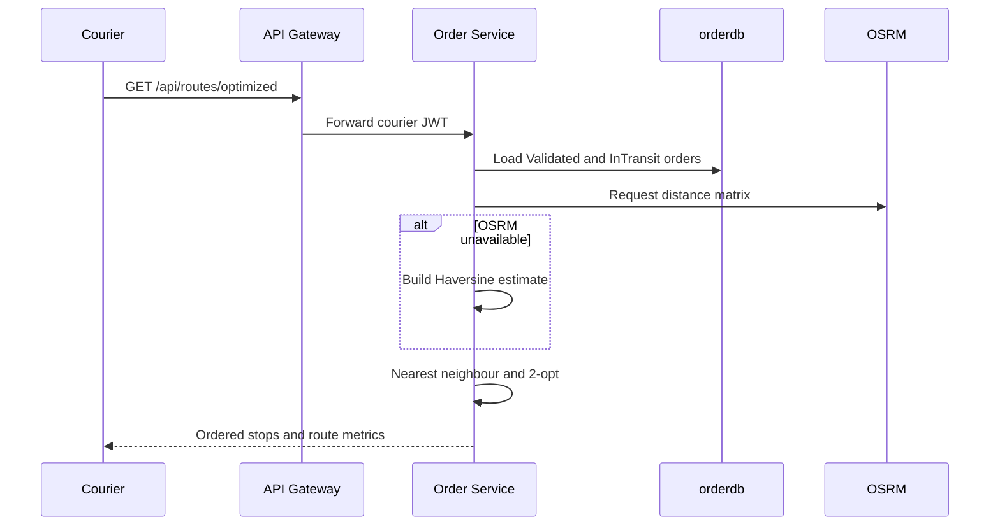

# Sequence diagrams

## Login

## Create an order

## Assign and deliver an order

## Pay an order

The return page and `GET /api/payments/{orderId}` can query Stripe again when
the webhook has not arrived.

## Optimise a courier route

