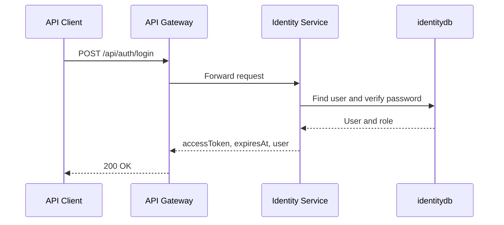
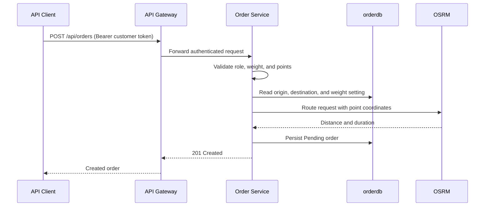
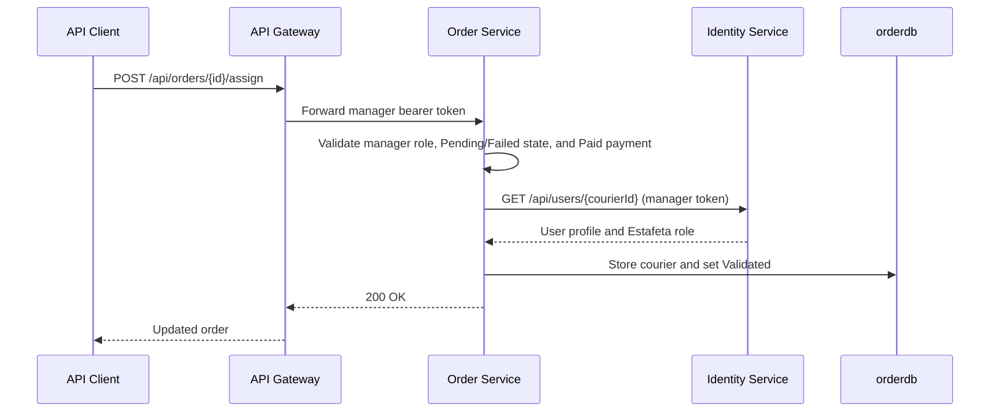
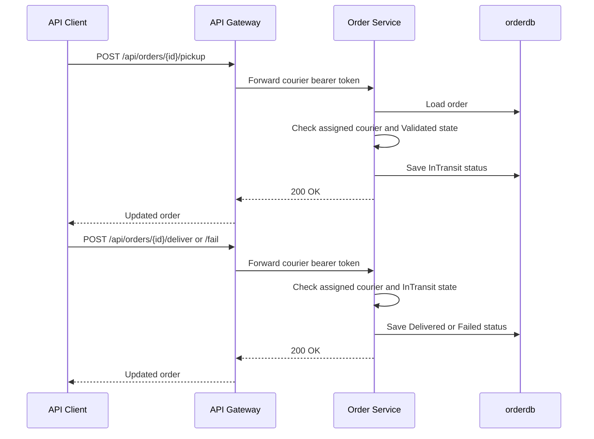
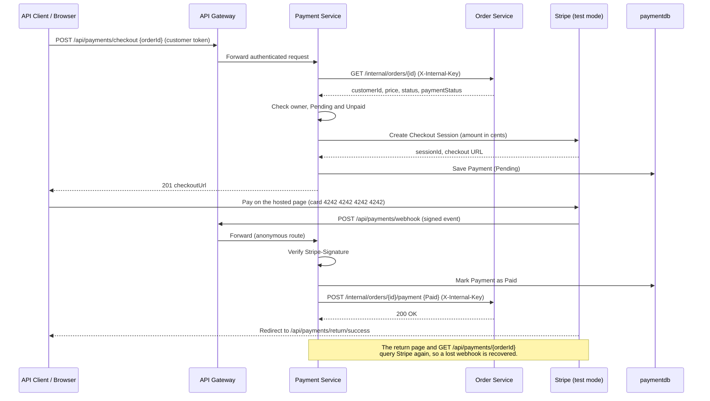
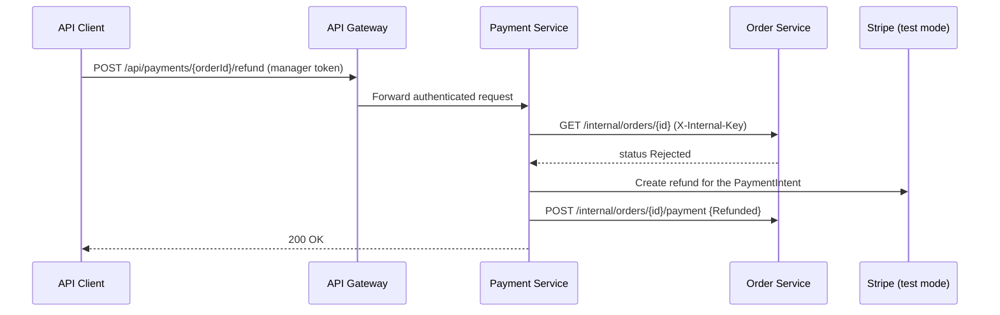
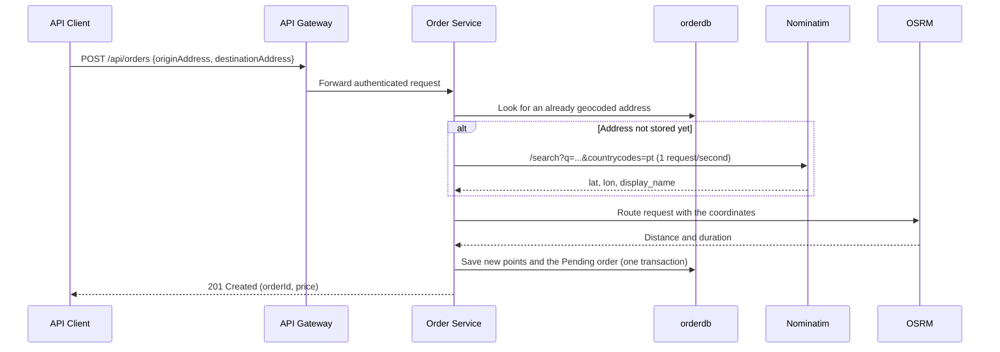

# Sequence Diagrams

## 1. Login

## 2. Create order

## 3. Assign order

## 4. Update delivery status

## 5. Pay an order (Stripe Checkout)

## 6. Refund a rejected order

## 7. Create order with free-text addresses

